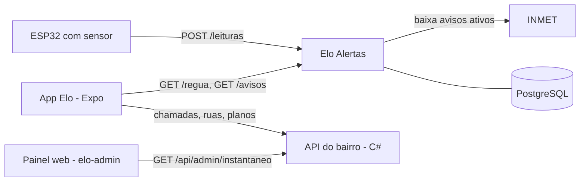
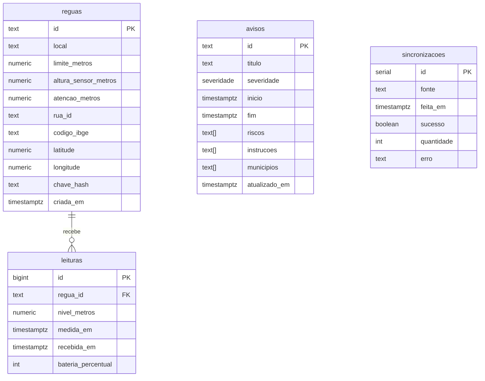

# Elo Alertas

Serviço de SOA do projeto Elo (Global Solution 2026.2, FIAP). O Elo é um app que faz a chamada das ruas de um bairro durante chuva forte. Este serviço cuida de duas coisas e só delas:

1. **Sensor**: recebe as leituras da régua de nível (ESP32 com sensor ultrassônico) e devolve a última leitura e o histórico.
2. **Avisos**: baixa os avisos do INMET (cerca de 580 KB, Brasil inteiro), guarda no banco e devolve só os avisos de um município (código IBGE), em poucos bytes.

As chamadas, as ruas e os planos do bairro ficam em outro serviço, em C# (`elo-api-csharp`), que também alimenta o painel web de administração (`elo-admin`). Os dois serviços não trocam dados: cada régua daqui só guarda o id da rua na API em C# (`rua_id`) e o município (`codigo_ibge`). A API em C# também tem `POST /leituras` e `GET /regua`, no mesmo formato, e é dela que o app e o painel leem a régua hoje. Se a régua mandar a leitura só para este serviço, o app e o painel não a veem; quem recebe na demonstração é decisão do grupo.

## Onde entra no Elo



## Como rodar do zero

Precisa de Node 24 e Docker.

1. Instale as dependências: `npm install`
2. Crie o arquivo de ambiente: `cp .env.example .env` (e troque `CHAVE_REGUA_EXEMPLO` por uma chave sua)
3. Suba o Postgres (container `elo-alertas-db`, porta 54340): `npm run db:subir`
4. Aplique as migrações: `npm run db:migrar`
5. Crie a régua de exemplo e leituras fictícias: `npm run db:seed`
6. Suba o serviço: `npm run dev` (porta 3040). Para a versão compilada: `npm run build` e depois `npm start`
7. Abra a documentação em <http://localhost:3040/docs>

Para parar o banco sem apagar os dados: `npm run db:parar`.

Exemplo de envio do ESP32 (use a chave do seu `.env`):

```bash
curl -i -X POST http://localhost:3040/leituras \
  -H 'Content-Type: application/json' \
  -H 'X-Chave-Dispositivo: troque-esta-chave-de-exemplo' \
  -d '{"reguaId":"regua-exemplo","nivelMetros":0.87,"bateriaPercentual":91}'
```

### Variáveis de ambiente

| Variável | Para que serve |
| --- | --- |
| `DATABASE_URL` | Conexão com o Postgres |
| `PORTA` | Porta do serviço (padrão 3040) |
| `CHAVE_REGUA_EXEMPLO` | Chave da régua de exemplo; o seed guarda só o hash sha256 |
| `INMET_URL` | Endereço dos avisos ativos do INMET |
| `AVISOS_VALIDADE_MIN` | Minutos até a sincronização com o INMET vencer (padrão 5) |

## Endpoints

A lista completa, com exemplos e respostas de erro, está em `/docs` (Swagger gerado das próprias rotas). Erros sempre vêm como `{ "erro": "codigo", "mensagem": "texto" }`.

| Método e rota | O que faz |
| --- | --- |
| `GET /saude` | Diz se o serviço e o banco estão no ar (503 se o banco não responde) |
| `GET /regua?reguaId=` | Última leitura da régua, com rua, município, coordenada e nível de atenção; sem `reguaId`, a primeira régua por id |
| `GET /reguas?codigoIbge=` | Lista as réguas com a última leitura e a localização; com `codigoIbge` (7 dígitos), só as do município; outro formato dá 400 (nunca expõe a chave; os ids são públicos, como o nome de uma rua) |
| `GET /reguas/{id}/leituras?horas=6` | Histórico, de 1 a 72 horas, até 500 itens |
| `POST /leituras` | O ESP32 envia o nível; exige o header `X-Chave-Dispositivo` (204) |
| `GET /avisos?codigoIbge=` | Avisos do INMET para o município, do mais grave ao mais leve |

`GET /regua` tem o formato que o app já lê, mais cinco campos opcionais: `ruaId`, `codigoIbge`, `latitude`, `longitude` e `atencaoMetros`. Todos saem `null` quando a régua não tem o dado, e a coordenada vem sempre em par. Quem lê a versão antiga ignora o que não conhece. A localização vem do seed: não há rota para gravá-la. Cada aviso de `GET /avisos` traz os campos do tipo `Aviso` do app (incluindo `gravidade` e `quando`). Com a API do bairro configurada, o app lê a lista pronta do `GET /avisos` da API em C#, que tem o mesmo formato; sem ela, baixa o INMET direto. Para usar este serviço no lugar, basta trocar o endereço. Em `GET /avisos`, o header `X-Avisos-Atualizados-Em` traz a hora da última sincronização com sucesso.

Como o aviso é atualizado: o serviço lê do banco. Se a última sincronização com sucesso passou de `AVISOS_VALIDADE_MIN` minutos, baixa o INMET antes de responder e troca os avisos numa transação. Se o INMET falhar ou passar de 8 s (o app desiste em 10 s), a falha fica registrada em `sincronizacoes` e a resposta usa o que já está no banco, sem os avisos que já terminaram. Depois de uma falha, o serviço espera 1 minuto antes de tentar o INMET de novo.

## Princípios de SOA no código

| Princípio | Onde aparece |
| --- | --- |
| Contrato padronizado | Schemas TypeBox em `src/http/rotas/` viram validação e OpenAPI; erros sempre no mesmo formato |
| Baixo acoplamento | `src/dominio` não importa Fastify nem Prisma; a infra implementa as portas de `src/dominio/portas.ts` |
| Abstração | O app recebe 6 rotas simples; baixar, normalizar e cachear o INMET fica escondido atrás de `GET /avisos` |
| Reuso | Os casos de uso em `src/aplicacao` servem a qualquer entrada; `montarApp` e o `servidor.ts` usam os mesmos |
| Autonomia | O serviço é dono do próprio banco e das próprias migrações; nenhum outro serviço lê as tabelas |
| Sem estado entre chamadas | Cada requisição traz tudo de que precisa (chave, parâmetros); o estado fica no banco. Só a sincronização em andamento e a hora da última falha do INMET vivem na memória |
| Descoberta | `/docs`, `/docs/json` (OpenAPI) e `/saude` descrevem e verificam o serviço |
| Composição | O app compõe este serviço com a API do bairro e o INMET; internamente, `listarAvisos` compõe repositório, sincronizador e regras do domínio |

## Estrutura

```
src/
  dominio/     entidades, regras puras e portas (regua.ts, aviso.ts, erros.ts, portas.ts)
  aplicacao/   casos de uso (registrarLeitura, consultarRegua, listarHistorico, listarAvisos, sincronizarAvisos)
  infra/       Prisma (repositórios) e INMET (fetch com timeout de 8 s)
  http/        Fastify: montarApp, Swagger, tratamento de erro e rotas
  servidor.ts  lê o ambiente, liga o Prisma e sobe a porta
prisma/        schema, migrações e seed
test/          unidade (memória) e integração (Postgres real)
```

## Modelo do banco



Migrações (em `prisma/migrations`, aplicadas com `prisma migrate deploy`):

1. `reguas_e_leituras`: tabelas `reguas` e `leituras`, com índice por régua e `medida_em` decrescente.
2. `avisos_inmet`: enum `severidade`, tabelas `avisos` (com índice GIN em `municipios`) e `sincronizacoes`.
3. `regras_no_banco`: escrita à mão, porque o Prisma não descreve `CHECK`. Nível entre 0 e 20 m, bateria entre 0 e 100, limite positivo, aviso com `fim` depois de `inicio`, e índice por `recebida_em` para achar a última leitura.
4. `localizacao_e_atencao`: cinco colunas novas e opcionais em `reguas` (`rua_id`, `codigo_ibge`, `latitude`, `longitude`, `atencao_metros`), com `CHECK` à mão: coordenada em par e dentro do mapa, município com 7 dígitos e atenção maior que 0 e menor que o limite.

Os campos novos da régua:

| Coluna | Tipo | Para que serve |
| --- | --- | --- |
| `rua_id` | texto | Id da rua na API do bairro (em C#), em texto |
| `codigo_ibge` | texto, 7 dígitos | Município da régua; é o filtro de `GET /reguas?codigoIbge=` |
| `latitude`, `longitude` | `numeric(9,6)` | Onde a régua está; as duas ou nenhuma |
| `atencao_metros` | `numeric(5,2)` | Nível a partir do qual a régua pede atenção; menor que `limite_metros` |

O seed grava `regua-exemplo` com os dados do piloto: rua `7` (Rua das Palafitas), Jardim Pantanal, São Paulo/SP (`3550308`), latitude `-23.476551`, longitude `-46.41135`, limite 1,20 m e atenção 1,00 m (o `LIMITE_CM=120` e os 100 cm de atenção do firmware).

Exemplo de resposta de `GET /regua?reguaId=regua-exemplo`:

```json
{
  "reguaId": "regua-exemplo",
  "local": "Córrego do bairro de exemplo",
  "nivelMetros": 0.93,
  "limiteMetros": 1.2,
  "medidaEm": "2026-11-14T22:30:00.000Z",
  "ruaId": "7",
  "codigoIbge": "3550308",
  "latitude": -23.476551,
  "longitude": -46.41135,
  "atencaoMetros": 1
}
```

Régua sem localização devolve os mesmos campos com `null`.

A chave do dispositivo nunca é guardada: só o hash sha256, comparado com `crypto.timingSafeEqual`.

## Testes

- `npm test`: unidade, sem banco e sem rede (domínio e casos de uso com repositórios em memória, incluindo a fixture real do INMET).
- `npm run test:integracao`: Postgres real do compose, banco `elo_alertas_teste` (as migrações são aplicadas antes). Precisa de `npm run db:subir`. A fonte do INMET é sempre uma versão falsa; nenhum teste usa a rede.
- `npm run lint`: checagem de tipos (`tsc --noEmit`). `npm run build`: compila para `dist/`.

## Evidências

Em `docs/evidencias/`: saída dos testes, saída dos `curl` dos endpoints principais, o JSON do OpenAPI, o print do Swagger (`09-swagger.png`) e os `curl` dos campos novos da régua e do filtro por município (`10-localizacao.txt`).

## Dados e custos

- Nenhum dado pessoal: a régua, o local e as leituras do seed são fictícios. Os avisos são dados públicos do INMET, citados como fonte.
- A chave do dispositivo nunca fica no repositório: vem do `.env`, e o banco guarda só o hash.
- Custo zero: Postgres local no Docker e a API pública do INMET, sem chave.

## Integrantes

| Nome | RM |
| --- | --- |
| João Victor |  |
| Bruno |  |
| Rodrigo |  |
| Lucca |  |
| Ruan |  |

## Uso de IA

A estrutura deste serviço foi gerada com Claude Code. O registro, o que a IA decidiu sozinha e o que a equipe precisa conferir estão em [`prompts.md`](./prompts.md).
